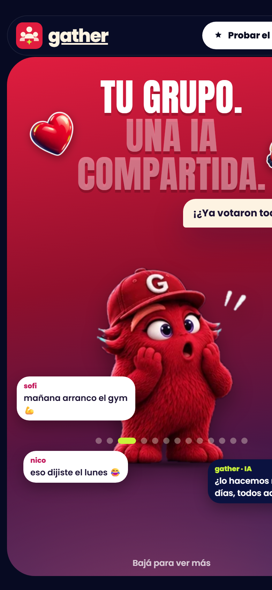
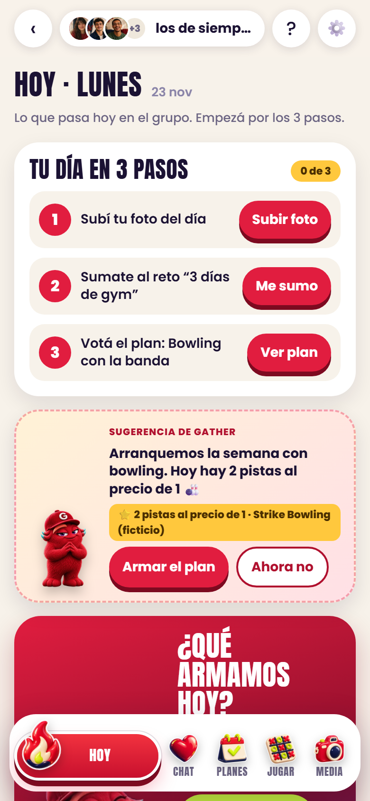
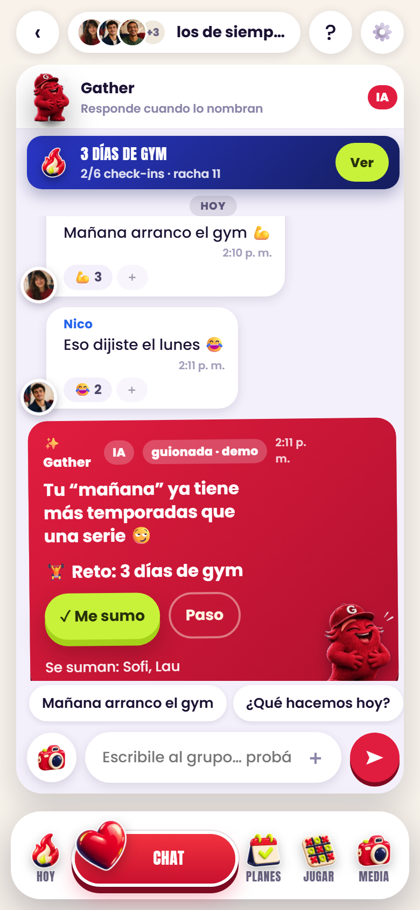
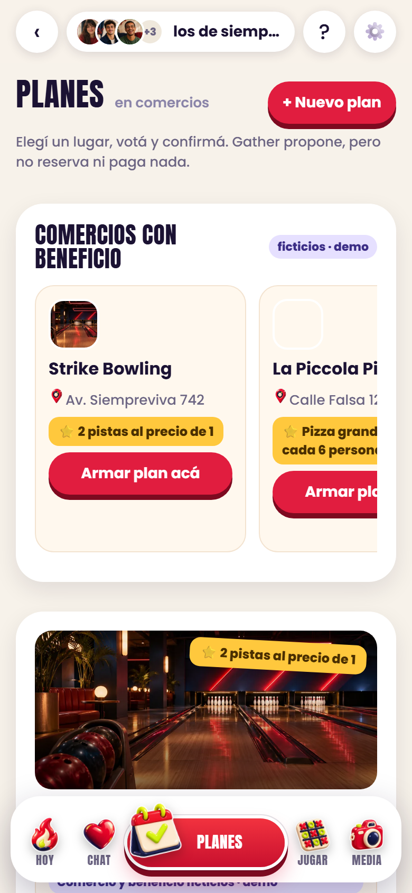
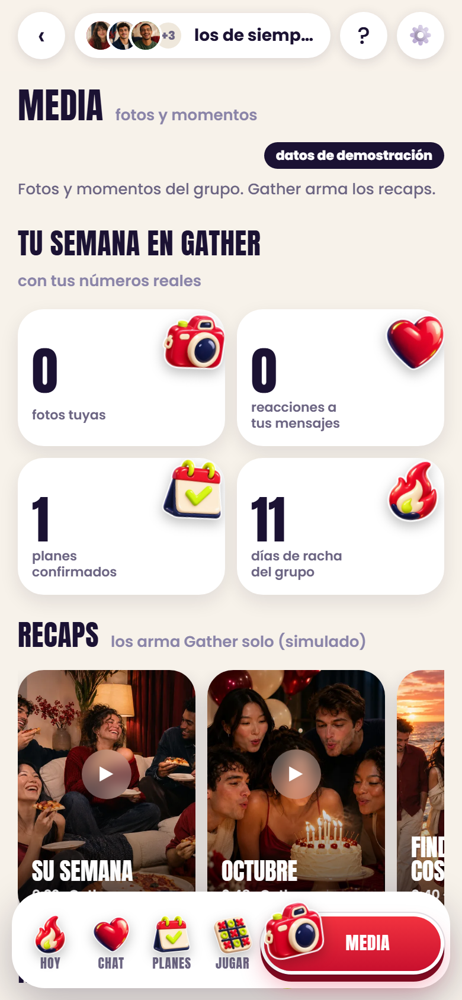

# gather

**Tu grupo. Una IA compartida. Más cosas juntos.**

Prototipo interactivo, pensado para celular, de una app social donde **un solo personaje de IA acompaña a todo el grupo de amigos**: charla con humor, convierte lo que dicen en retos, juegos y planes, y propone salidas en comercios con beneficio. Nombre provisional (antes *PINTA*).

> **Es una demostración.** No hay backend ni IA real: las respuestas de Gather están guionadas, y las personas, los comercios y los beneficios son ficticios.

<p align="center">
  
  
  
  
  
</p>

## Qué tiene

| Pantalla | Qué hace |
|---|---|
| **Portada** | Mascota que cambia de pose, burbujas de chat, tarjetas con maquetas de celular. |
| **Hoy** | "Tu día en 3 pasos", racha del grupo, foto del día (subís la tuya) y la sugerencia diaria de Gather. |
| **Chat** | Burbujas con hora y reacciones, fotos, tarjeta de racha fija. Gather arma retos (`gym`) y votaciones (`qué hacemos hoy`). |
| **Planes** | Planes en comercios ficticios con beneficio: votar, asistencia, confirmar, archivar, abrir a gente nueva (apagado por defecto) y **dividir la cuenta**. |
| **Jugar** | "¿Quién del grupo…?": 5 rondas, voto propio y resultados. |
| **Media** | Recaps, "Tu semana en Gather" con tus números y collage de fotos. |
| **Ajustes** | Frecuencia, silenciar, tono (tranquilo / juguetón / pícaro), qué puede usar la IA, palabras excluidas y memoria. |

**Gather propone; las personas confirman.** No reserva, no cobra y no transfiere dinero.

## Cómo abrirlo

Es HTML, CSS y JavaScript sin dependencias.

```bash
python -m http.server 5181
# abrir http://127.0.0.1:5181/
```

- Enlaces directos: `?tab=grupo`, `?tab=chat`, `?tab=planes`, `?tab=jugar`, `?tab=recuerdos`.
- Desde el celular (mismo Wi-Fi): `python -m http.server 5182 --bind 0.0.0.0` y abrir `http://<IP de tu compu>:5182/`.
- Incluye manifiesto para agregarla a la pantalla de inicio.

## Qué funciona y qué es simulado

- **Funciona de verdad (en el navegador):** navegación, votos, asistencia, retos, juego, dividir la cuenta, reacciones, ajustes y memoria (se guardan en `localStorage`), subir fotos (no salen de tu navegador).
- **Simulado:** toda la IA, los otros integrantes (votos, asistencia, fotos), comercios y beneficios, y los interruptores marcados "Simulado" en Ajustes.

## Mascota y animación

La mascota cambia entre **poses reales** (notebook, pintor, triste, enojada, corazón, manos juntas…) con transiciones de rebote; respeta `prefers-reduced-motion`. **No es animación corporal**: faltan clips de movimiento (ver [`ANIMACIONES.md`](ANIMACIONES.md)).

## Estructura

```
index.html        portada + app
landing.css       portada
app.css           interfaz de la app (mobile-first)
styles.css        base y componentes
app.js            estado, pantallas y lógica
fonts.css         Anton y Poppins (locales)
assets/           mascota, íconos sticker y fotos generadas con IA
docs/             capturas
```

Las imágenes (perfiles, comercios, recuerdos, íconos y poses) fueron generadas con IA y son ficticias.
